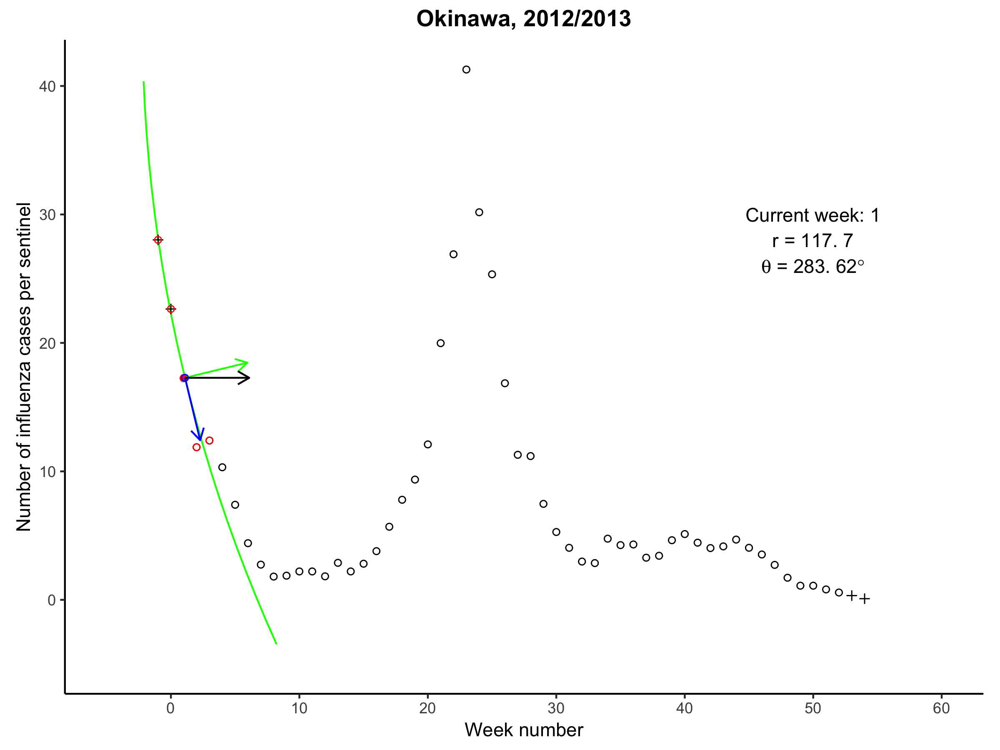

# MCM

Data and analysis code for Cai J, Zhang B, Xu B, Chan KK, Chowell G, Tian H, Xu B. A maximum curvature method for estimating epidemic onset of seasonal influenza in Japan. *BMC Infectious Diseases*. 2019 Feb 20;19(1):181. doi:[10.1186/s12879-019-3777-x](https://doi.org/10.1186/s12879-019-3777-x).

The following animation GIF shows the process of fitting least-squares circles for Okinawa during 2012/2013.

